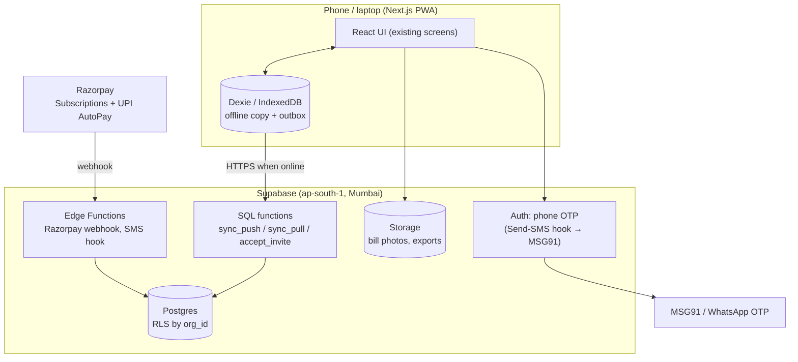

# Hisaab: Backend & Launch Plan (multi-org, multi-user, subscriptions)

*Prepared 16 Nov 2026 for the codebase on `main` (Next.js 16 + Dexie, repo `KANHA-KC/ledger`).*
*Prices are third-party estimates from Nov 2026. Re-check every vendor's pricing page before committing.*

---

## 0. TL;DR

**Today, Hisaab has no backend.** Every byte lives in the browser's IndexedDB on one device. Login (OTP), PIN, the team list, the plan and sync are local stand-ins. If a user clears the browser or loses the phone, their data is gone unless they made a Google Drive backup.

**Recommendation: easiest, low cost, scales well.**

| Layer | Pick | Why |
| --- | --- | --- |
| Database + Auth + File storage + APIs | **Supabase** (Postgres), **Mumbai region `ap-south-1`** | One vendor for DB, phone-OTP auth, row-level security (org isolation), file storage and server functions. Data stays in India (DPDP Act). Standard Postgres, so there's no lock-in. |
| Org isolation | **Postgres Row-Level Security (RLS)** on `org_id` | Isolation is enforced by the database itself, not by app code you might forget. |
| Sync (offline-first) | Keep **Dexie on device** + two Postgres functions, **`sync_push` / `sync_pull`** | No sync server to run. The existing offline design stays. |
| OTP SMS | Supabase Auth **"Send SMS" hook → MSG91** (DLT-registered). WhatsApp OTP as a cheaper fallback. | About ₹0.15–0.25 per OTP. Indian DLT compliance. |
| Subscriptions | **Razorpay Subscriptions** (UPI AutoPay + cards) + webhook | Indian users trust it. Supports UPI AutoPay mandates. |
| Hosting (web app) | **Vercel Pro**, region `bom1` (or Cloudflare to save money, see §9) | Zero-ops Next.js hosting. |
| Errors / analytics | Sentry (free tier) + PostHog (free tier) | Free at launch volume. |

**Running cost:** about **$45–60/month (~₹4–5k)** for the pilot through the first few thousand shops, plus usage costs (SMS, payment fees). See §10.

**Effort:** about **8–10 weeks** for one full-stack developer to a paid launch (§11).

---

## 1. Where it stands today: done vs. missing

### 1.1 Done (frontend, works offline on one device)

| Area | Status |
| --- | --- |
| Entry flow (amount → category → save, undo, edit, 30-day bin) | ✅ |
| Categories (defaults by business type, custom, hide, merge), wallets, transfers | ✅ |
| Udhaar / parties, running balances, WhatsApp reminder links | ✅ |
| Dashboard, filters, reports, PDF/CSV export | ✅ |
| Hindi/English UI, Hinglish transliteration, voice entry | ✅ |
| Double-entry ledger lines, amounts in paise, device UUIDs | ✅ Already server-ready (good foundation) |
| `syncStatus: 'pending'` on every entry | ✅ Queue flag exists |
| Encrypted backup to the user's own Google Drive (`lib/backup.ts`) | ✅ Per device; this is a personal backup, not sync |
| Profile / Team UI (`ProfileOrgSheet.tsx`, roles `admin / editor / viewer`) | 🟡 **UI only.** Members live in local settings and roles in `localStorage`. Nothing is enforced, and other people can't actually log in. |

### 1.2 Missing (everything a backend does)

| Need | Current state | Gap |
| --- | --- | --- |
| Real login | `lib/auth.ts`: OTP hard-coded `123456`; PIN hash in IndexedDB | No identity, no session, anyone can "log in" |
| Data stored in the cloud | IndexedDB only | Data loss on device loss; no access from a second device |
| Organisations & members | Single `Business` row, no `orgId`, no user table | No tenant model, invites, or role enforcement |
| Sync | `lib/sync.ts` pushes only `txns` to a non-existent URL | No pull, and categories, parties, accounts and photos never sync; no conflict handling |
| Subscriptions | `business.plan = 'free'`, trial date set locally | No payments, no entitlements, and the user can change it locally |
| Bill photos | Blobs in IndexedDB | Never leave the device |
| Audit log / edit history | `txn.history[]` on device | Not tamper-proof, not visible to the owner across devices |
| Compliance (DPDP Act 2023) | n/a | Privacy policy, consent, data-deletion flow, India data residency |

### 1.3 🚨 Launch blockers already in the code (fix first)

1. **`components/AppShell.tsx` (startup) changes real data on every launch:**
   - `seedDummyEntriesForAllCategories(b.id, 4)` adds fake entries to **every** business.
   - `removeAllUdhaarTransactions(b.id)` **deletes all udhaar entries** every time the app opens.
   - `cleanPartyNames(b.id)`, and the "Sharma Enterprises" / "Dilip Chandravanshi" renames, overwrite user data.
   - **Fix:** run these only in a demo mode (e.g. `NEXT_PUBLIC_DEMO=1` or `business.id === DEMO_BUSINESS_ID`), never for real accounts.
2. `ProfileOrgSheet.tsx` defaults the user name to a real person's name and lets anyone set themselves to `admin` in `localStorage`. Replace it with server data (§5).
3. `lib/auth.ts` `DEMO_OTP` / `DEMO_PIN`: remove them from production builds.

---

## 2. Target architecture



**Key idea:** the app stays offline-first. The device writes to Dexie and queues changes. When online, it calls `sync_push` with its changes and `sync_pull` to fetch what changed since its last cursor. Postgres is the source of truth and enforces who can see what.

---

## 3. Option comparison

| | **A. Supabase** ✅ recommended | B. Firebase (Firestore) | C. Own API (Next.js routes / NestJS) + Neon or RDS + Better Auth | D. Self-hosted VPS (PocketBase or Postgres + Node) |
| --- | --- | --- | --- | --- |
| Effort to launch | **Low** | Low | High (you build auth, RLS-equivalent, storage, admin) | Medium–high plus ops |
| Fit for a ledger (SQL reports, sums, joins) | **Excellent** (Postgres) | Poor (NoSQL; aggregates are painful and costly) | Excellent | Good |
| Org isolation | **RLS in the DB** | Security rules (workable) | In app code (easy to get wrong) | In app code |
| Phone OTP | Built in, with a custom SMS hook for MSG91 | Built in (Google's SMS pricing) | Build it yourself or use a vendor | Build it yourself |
| India region | Mumbai ✅ | Mumbai ✅ | Neon: check region; RDS Mumbai ✅ | Any Indian VPS ✅ |
| Cost at launch | ~$25/mo | ~$0–25 (pay per read; spikes with dashboards) | $20–60/mo + much more dev time | $10–20/mo VPS + your time on backups and patching |
| Scale path | Bigger compute, read replicas, PITR; or move to any Postgres host | Auto-scales; cost grows with reads | Unlimited | Manual |
| Lock-in | Low (plain Postgres + SQL) | High | None | None |

**Why not just a sync product (PowerSync / ElectricSQL)?** They solve offline sync very well and integrate with Supabase. They're a good **Plan B** if hand-written sync becomes a burden, but they add another vendor and bill. Hisaab's data is simple (append-mostly entries keyed by UUIDs), so two SQL functions are enough.

---

## 4. Multi-tenant data model

### 4.1 Concepts

```
User (phone login)
  └─ Membership (role) ──> Organisation  (billing + seats live here)
                              └─ Business(es)   (MVP: 1 per org; Pro: many)
                                    └─ accounts, categories, parties, txns, ledger_lines, photos
```

- **Organisation** = the paying customer (a shop, a family business, an SHG).
- **User** = a person with a phone number. **One user can belong to several orgs** (e.g. a CA serving 20 shops).
- **Role per membership**, matching the plan's personas and the existing `MemberRole`:

| Role (code) | Plan persona | Can do |
| --- | --- | --- |
| `owner` *(new)* | Owner | Everything, including billing, deleting the org and transferring ownership |
| `admin` | Owner / manager | Everything except billing ownership; manage members |
| `editor` | Helper | Add and edit entries, parties and categories; cannot delete others' entries or see billing |
| `viewer` | Accountant (read-only) | Read and export only |

### 4.2 Tables (Postgres)

Every business-data table gets `org_id`, `business_id`, `created_by`, `updated_by`, `updated_at`, `deleted_at` and `server_version`. **IDs stay device-generated UUIDs**, so offline inserts never collide.

```sql
-- ===== identity & tenancy =====
create table profiles (
  id uuid primary key references auth.users on delete cascade,
  name text not null default '',
  phone text unique,
  language text not null default 'hi',
  created_at timestamptz not null default now()
);

create table organizations (
  id uuid primary key default gen_random_uuid(),
  name text not null,
  created_by uuid not null references profiles(id),
  created_at timestamptz not null default now()
);

create type member_role as enum ('owner','admin','editor','viewer');

create table memberships (
  org_id uuid references organizations on delete cascade,
  user_id uuid references profiles on delete cascade,
  role member_role not null,
  created_at timestamptz not null default now(),
  primary key (org_id, user_id)
);

create table invitations (
  id uuid primary key default gen_random_uuid(),
  org_id uuid not null references organizations on delete cascade,
  phone text not null,                 -- invite by phone; auto-accepted on first login
  role member_role not null check (role <> 'owner'),
  invited_by uuid not null references profiles(id),
  expires_at timestamptz not null default now() + interval '14 days',
  accepted_at timestamptz,
  unique (org_id, phone)
);

create table businesses (
  id uuid primary key,                 -- device UUID kept
  org_id uuid not null references organizations on delete cascade,
  name text not null, type text not null, language text not null,
  fy_start_month int not null default 4,
  updated_at timestamptz not null default now(), deleted_at timestamptz,
  server_version bigint not null default 0
);

-- ===== ledger data (mirrors app/src/db/types.ts) =====
-- accounts, categories, parties, txns, ledger_lines, photos:
--   same columns as today + org_id, business_id, created_by, updated_by,
--   updated_at, deleted_at, server_version
-- txns.amount bigint (paise), ledger_lines.debit/credit bigint

-- ===== billing =====
create table subscriptions (
  org_id uuid primary key references organizations on delete cascade,
  plan text not null default 'free',         -- free | basic | pro | group
  status text not null default 'trialing',   -- trialing | active | past_due | cancelled
  trial_ends_at timestamptz,
  current_period_end timestamptz,
  razorpay_subscription_id text unique,
  seats int not null default 1,
  updated_at timestamptz not null default now()
);

-- ===== audit =====
create table audit_log (
  id bigserial primary key,
  org_id uuid not null, actor uuid, table_name text, row_id uuid,
  action text, before jsonb, after jsonb, at timestamptz not null default now()
);
```

**Sync cursor:** one global sequence. A trigger on every synced table sets `server_version = nextval('sync_seq')` on insert and update, so "give me everything after version N" is a single indexed query.

**Indexes:** `(business_id, server_version)` on every synced table; `(business_id, date)` on `txns`.

**Scale later:** partition `txns` and `ledger_lines` by `business_id` hash (or by month) once they pass about 50–100M rows. The schema doesn't change.

### 4.3 Row-Level Security (the core of org isolation)

```sql
create function is_member(o uuid, min_role member_role default 'viewer')
returns boolean language sql stable security definer set search_path = public as $$
  select exists (
    select 1 from memberships m
    where m.org_id = o and m.user_id = auth.uid()
      and array_position(array['viewer','editor','admin','owner']::member_role[], m.role)
       >= array_position(array['viewer','editor','admin','owner']::member_role[], min_role)
  );
$$;

alter table txns enable row level security;
create policy read  on txns for select using (is_member(org_id));
create policy write on txns for insert with check (is_member(org_id, 'editor'));
create policy edit  on txns for update using (is_member(org_id, 'editor'));
-- repeat for accounts, categories, parties, ledger_lines, photos, businesses
-- memberships/invitations: write requires 'admin'; subscriptions: read members, write service-role only
```

**Rules:**
- The client never sends `org_id` for authorisation. Postgres checks it against `auth.uid()`.
- `subscriptions` is written only by the Razorpay webhook (service role), never by the app.
- Storage bucket `bills/` uses the path `org_id/business_id/photo_id.jpg`, with a storage policy that calls the same `is_member()`.

---

## 5. Auth and multi-user flows

### 5.1 Login
1. User enters a phone number. Supabase Auth `signInWithOtp({ phone })` triggers the **Send SMS Hook**, which sends the OTP through MSG91 (DLT template). WhatsApp OTP is the fallback.
2. `verifyOtp` returns a session (JWT plus refresh token, stored by `supabase-js`). Sessions last weeks, so OTP is needed only on a new device. That keeps SMS costs low.
3. **The 4-digit PIN stays a device lock** on top of the session (current `Lock.tsx`). "Forgot PIN" becomes a real OTP re-verification.
4. Offline: the app opens from IndexedDB with the cached session. The token refreshes when the network returns.

**Prerequisite for India SMS:** TRAI **DLT registration** (entity, sender ID/header and OTP template). Budget 1–2 weeks of paperwork and small one-time fees. Start it early.

### 5.2 First login → org
- No membership and no pending invite: onboarding creates the **organisation + business + owner membership + trial subscription** in one SQL function, `create_org(...)`.
- Pending invite for this phone: `accept_invite()` adds the membership and the app opens that org.

### 5.3 Invite a member (replaces the local-only `ProfileOrgSheet` team list)
1. Admin enters a phone and role, which inserts into `invitations`. The app shares a WhatsApp link ("You've been added to {shop} on Hisaab").
2. The invitee logs in with that phone and is auto-joined.
3. **Seat limit** comes from the plan (§7). A `before insert` trigger on `memberships` rejects the insert when it's over the limit.
4. Remove a member: delete the membership. Their device loses access on the next sync, and RLS blocks reads immediately.

### 5.4 Switching orgs
- An org switcher lives in More / Profile. Dexie keeps a **separate local database per org** (`hisaab_<orgId>`), so data never mixes on a shared phone.

---

## 6. Sync design (offline-first, no sync server)

### 6.1 Push: `sync_push(business_id, changes jsonb)` (Postgres function, called via `supabase.rpc`)
- `changes` = rows from the local outbox for **all** tables (accounts, categories, parties, txns), not just txns as today.
- Each row is an **idempotent upsert by UUID**, so retries are safe.
- **Conflicts:** last-write-wins per row on `updated_at`, with the server rejecting timestamps far in the future (clock-skew guard). The losing version goes to `audit_log`, so nothing is silently lost.
- **Ledger lines are rebuilt on the server** from the txn (port `buildLines` from `db/ledger.ts` to SQL or a trigger). The device's lines are never trusted, as the product plan requires.
- **Role check:** editors can't edit or delete others' entries if you choose that rule. Viewers can't push at all.
- Returns the new `server_version`.

### 6.2 Pull: `sync_pull(business_id, since bigint)`
- Returns all rows with `server_version > since` (including soft-deleted ones, so deletions propagate), plus the new cursor.
- **Plan limits are applied here.** On Free, history older than 3 months isn't returned for reports; old data is kept but not shown.

### 6.3 Client changes
- Dexie schema v2: add `orgId`, `updatedBy`, `serverVersion` and a generic `outbox` table. Migration: existing local rows are claimed by the new org on first login, which uploads the user's pre-login data.
- Replace `lib/sync.ts`: push outbox, then pull since cursor. Trigger on app start, `online` events, after each save (debounced) and every 60 s.
- **Photos:** upload queue to Supabase Storage. The row stores `photo_path`, and the blob is downloaded lazily on other devices.
- Optional later: Supabase Realtime on `txns` so a helper's entry appears on the owner's phone instantly.

---

## 7. Subscriptions and entitlements

### 7.1 Plans → entitlements (one table, checked on the server)

| Entitlement | Free (Muft) | Basic ₹49/mo · ₹499/yr | Pro ₹149/mo · ₹1,499/yr | Group (SHG/NGO) |
| --- | --- | --- | --- | --- |
| Users (seats) | 1 | 1 | 5 | custom |
| Businesses per org | 1 | 1 | 5 | custom |
| Visible report history | 3 months | full | full | full |
| PDF/Excel export, bill photos, WhatsApp reminders, voice | ❌ | ✅ | ✅ | ✅ |
| Accountant (viewer) access | ❌ | ❌ | ✅ | ✅ |

- **30-day Basic trial** for every new org (`subscriptions.status = 'trialing'`).
- **Never lock users out of their data:** a lapsed plan drops to Free. Entry and viewing continue; premium features pause. This is enforced in `sync_pull`, the export endpoints and RLS on `photos`.

### 7.2 Razorpay flow
1. The app calls an Edge Function, `create-subscription(plan, period)`, which creates the Razorpay Subscription and returns Razorpay's checkout. The user approves a **UPI AutoPay mandate** or a card.
2. Razorpay **webhooks** (`subscription.activated`, `charged`, `halted`, `cancelled`) go to an Edge Function. It **verifies the signature** and updates `subscriptions`.
3. The app reads `subscriptions` (read-only) and shows status. The UI never decides entitlements by itself.
4. **Push yearly plans** (the plan notes monthly mandates fail on low balances).
5. GST: you need a GSTIN to charge GST and issue tax invoices. Razorpay can send receipts; confirm the invoicing setup with your CA.

**Fees (estimate):** about 2% gateway + about 0.99% subscriptions add-on, plus 18% GST on the fee. That's roughly ₹18 on a ₹499 yearly plan. Razorpay currently advertises a 0% platform-fee offer for new merchants; check the terms.

---

## 8. Security and compliance (DPDP Act 2023)

- **Data residency:** Supabase project in **ap-south-1 (Mumbai)**; Vercel functions in `bom1`.
- **Encryption:** TLS in transit and at rest (Supabase default). Keep the existing optional E2EE Google Drive backup as a power-user feature.
- **Backups:** Pro includes daily backups. Add **PITR (point-in-time recovery)** before the paid launch; the plan asks for 30-day PITR, a paid add-on.
- **Audit:** triggers write every insert, update and delete on ledger tables to `audit_log`. The owner can see "who changed what".
- **Abuse:** OTP rate limits (per phone and per IP, configurable in Supabase Auth), CAPTCHA on OTP after N attempts, and API rate limits.
- **DPDP basics:** privacy policy + consent at signup, "Download all my data" (already exists; make it server-side), **account and data deletion request** flow, a breach-notification process and a named grievance officer.
- **Secrets:** Supabase service-role key, Razorpay secret and MSG91 key live only in Edge Function and Vercel environment variables, never in `NEXT_PUBLIC_*`.

---

## 9. Hosting the web app

| Option | Cost | Notes |
| --- | --- | --- |
| **Vercel Pro** (recommended for speed) | ~$20/member/mo | Native Next.js 16, Mumbai `bom1` functions, previews per PR. Hobby is **non-commercial only**, so it's not allowed for a paid product. |
| Cloudflare Workers/Pages (via OpenNext) | $0–5/mo | Cheapest at scale with generous free bandwidth. Slightly more setup for Next.js. |
| Static export to any CDN | ~$0 | Possible because the app is client-side (Dexie). Dynamic routes need refactoring, and server work moves to Supabase Edge Functions. |

Since all business logic lives in Supabase, the hosting choice is easy to change later.

---

## 10. Cost model (estimates; verify before launch)

**Assumptions:** about 25 entries per shop per week (the plan's target) → ~1,300 entries per shop per year → ~2–3 MB per shop per year in Postgres including ledger lines and indexes. Photos are compressed to ~150 KB, ~20 per shop per month. Average 2 OTPs per user per month.

| Item | Pilot (100 shops) | Early growth (5,000 orgs) | Scale (50,000 orgs) |
| --- | --- | --- | --- |
| Supabase | Pro **$25** | Pro $25 + larger compute ~$50–110 | Team plan or compute ~$300–600 + replicas |
| ↳ DB size | < 1 GB | ~13 GB/yr (~$1/mo over 8 GB) | ~130 GB/yr (→ partition tables) |
| ↳ Photo storage | < 1 GB | ~180 GB/yr (100 GB included, then ~$0.02/GB) | ~1.8 TB/yr (consider Cloudflare R2 with zero egress) |
| ↳ Auth MAU | free | free (100k included) | ~free to small |
| PITR add-on | optional | ~$100/mo | ~$100–400/mo |
| Vercel Pro | $20 | $20–40 | $40–150 (or Cloudflare ~$5–25) |
| OTP SMS (~₹0.15–0.25 each) | ~₹50 | ~₹2,000–2,500 | ~₹20–25k |
| Sentry / PostHog | free | free → ~$26 | ~$100+ |
| **Fixed infra / month** | **~$45 (₹4k)** | **~$200–300 (₹17–25k)** | **~$600–1,300 (₹50k–1.1L)** |
| Razorpay fees | ~3% + GST on revenue | same | negotiate below 2% |

**Unit economics check:** at 5,000 orgs with 6% paid on ₹499/yr ≈ ₹1.5 lakh/yr revenue vs ≈ ₹2.5–3.5 lakh/yr infra. Free users are the cost. Keep Free cheap: no photos, a 3-month view, no PITR for Free orgs, and lean on **yearly plans and B2B2C Group deals** (SHGs, banks, Bihan) as the plan suggests. Infra is cheap per user; **conversion rate is what decides profitability.**

---

## 11. Roadmap (one full-stack developer; about 8–10 weeks)

| Week | Milestone | Done when |
| --- | --- | --- |
| **0** (start now, in parallel) | Admin tasks: **DLT registration**, Razorpay KYC, GSTIN, domain, privacy policy | Template approved, Razorpay live keys |
| **1** | **Fix the launch blockers (§1.3).** Create Supabase project (Mumbai), schema + RLS + migrations in repo (`supabase/migrations`), CI | Demo seeding gated; `supabase db push` works; RLS tests pass |
| **2** | Phone OTP via Send-SMS hook → MSG91; `create_org`; replace `lib/auth.ts`; PIN becomes a device lock over the session | Real login on two phones |
| **3–4** | **Sync:** `sync_push` / `sync_pull`, server-side ledger lines, Dexie v2 migration + outbox, first-login upload of local data, photo upload queue | Entry on phone A appears on phone B; offline edits merge; no data loss in airplane-mode tests |
| **5** | **Multi-user:** invitations, roles, seat-limit trigger; wire `ProfileOrgSheet` to the server; org switcher; per-org Dexie DB; audit log view | Owner invites a helper (editor) and an accountant (viewer); permissions are enforced by the DB |
| **6** | **Billing:** plans/entitlements, Razorpay subscription + webhook Edge Function, trial, downgrade-to-free rules, upgrade screens | A test UPI AutoPay mandate activates Basic; cancelling falls back to Free with no data loss |
| **7** | Hardening: rate limits, Sentry, PostHog funnels, PITR, server-side "download all my data", account deletion, load test (k6) | Security checklist done |
| **8** | Pilot (50–100 shops), as the product plan gates | Week-4 retention measured |
| 9–10 | Buffer, fixes, Play Store TWA wrapper (optional) | Paid launch |

### Testing that must exist before launch
- **RLS tests:** a user from org A can never read or write org B (pgTAP or a script with two JWTs).
- **Sync tests:** duplicate push (idempotency), conflicting edits, a delete propagating, a device offline for 7 days.
- **Ledger tests:** server-rebuilt lines balance (sum debit = sum credit) for every txn type, including udhaar and on-credit.

---

## 12. Code changes in this repo (map)

| File | Change |
| --- | --- |
| `app/src/components/AppShell.tsx` | Gate demo seeding, renames and udhaar deletion behind demo mode; add session check before unlock |
| `app/src/lib/auth.ts` | Supabase phone OTP; remove `DEMO_OTP` / `DEMO_PIN` from prod |
| `app/src/lib/sync.ts` | Rewrite: outbox push + cursor pull for all tables + photo queue |
| `app/src/db/db.ts`, `db/types.ts` | Dexie v2: `orgId`, `updatedBy`, `serverVersion`, `outbox`; per-org DB name |
| `app/src/db/ledger.ts` | Keep for instant local balances; the server version becomes authoritative |
| `app/src/components/ProfileOrgSheet.tsx`, `screens/More.tsx` | Read and write `profiles`, `memberships`, `invitations`; remove `localStorage` roles and hard-coded names |
| `app/src/screens/Onboarding.tsx` | Real OTP; create org via `create_org`; accept invites |
| New `app/src/lib/supabase.ts` | Client singleton (`@supabase/supabase-js`) |
| New `supabase/migrations/*.sql` | Schema, RLS, sync functions, triggers |
| New `supabase/functions/razorpay-webhook`, `create-subscription`, `send-sms` | Billing + OTP hook |
| New `app/src/screens/Billing.tsx` | Plan status, upgrade, manage |

---

## 13. Open decisions for you

1. **Hosting:** Vercel Pro (simplest) or Cloudflare (cheapest)?
2. **Can an editor (helper) delete or edit entries made by others?** This affects RLS rules.
3. **One business per org at launch, or allow several on Pro from day one?** The schema supports both.
4. **OTP channel:** SMS only, or WhatsApp OTP first (cheaper, but needs a Meta business account)?
5. **Who runs DLT, Razorpay KYC and GST:** Alphalake or a partner entity?

---

### Sources for pricing estimates
- Supabase pricing (Pro $25/mo, 8 GB DB, 100k MAU, 100 GB storage; third-party summaries): [toolradar](https://toolradar.com/blog/supabase-pricing-2026), [MakerKit calculator](https://makerkit.dev/pricing-calculator/supabase), [focusreactive](https://focusreactive.com/blog/supabase-price/). Official: supabase.com/pricing
- Razorpay fees and subscriptions add-on: [Razorpay pricing explained](https://razorpay.com/blog/razorpay-payment-gateway-pricing-explained/), [Razorpay recurring billing](https://razorpay.com/blog/cheapest-payment-gateway-for-recurring-billing-e-nach-upi-autopay-and-subscription/), [Razorpay subscription terms](https://razorpay.com/terms/subscription-plans/)
- India OTP SMS pricing and DLT: [Message Central: SMS OTP pricing India](https://www.messagecentral.com/blog/sms-otp-pricing-india), [Bonvoice OTP guide 2026](https://bonvoice.com/insights/best-otp-sms-service-india-2026/), [RichAutomate SMS API pricing 2026](https://richautomate.in/blog/sms-api-pricing-india-2026)
