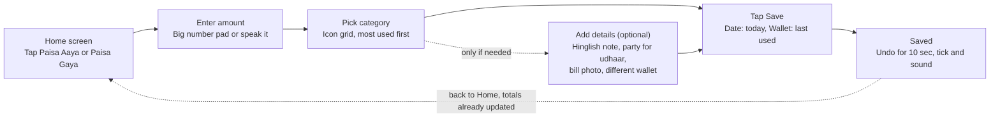
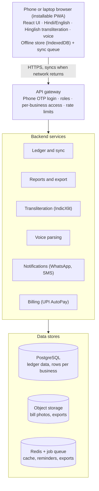
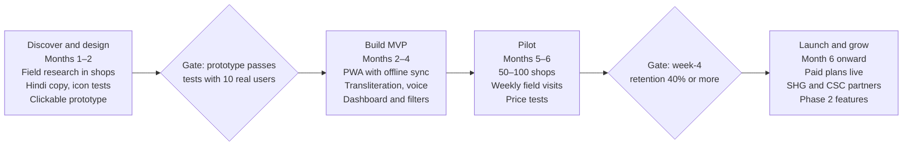

# Hisaab — Bilingual Ledger for MSMEs in Chhattisgarh: Product Plan

Nov 14, 2026

## 1. Vision, problem and users

Hisaab (working name) is a bilingual, mobile-first ledger that lets a small shop owner in Chhattisgarh record money in, money out, and see "am I making money?" in under 10 seconds per entry. It replaces the paper *khata* and the memory-based accounting most micro businesses still run on, without asking the owner to learn accounting.

**The problem.** Micro enterprises (kirana, hardware, tailoring, dairy, mandi traders, SHG-run units) mostly track money in a notebook or in their head. They cannot answer simple questions: how much did I spend on stock this month, who owes me, is the business growing. Existing apps (Tally, Vyapar, Khatabook) are either built for accountants, cluttered with GST/invoicing features, or English-first. Users in tier-3 towns and villages with low digital and text literacy drop off.

**Product promise:** *"Paisa aaya, paisa gaya — sab ek jagah, apni bhasha mein."*

**Primary personas**

| Persona | Context | Digital comfort | What they need most |
| --- | --- | --- | --- |
| Ramesh, 42, kirana owner, Bilaspur outskirts | Sells daily, buys stock weekly, gives *udhaar* | WhatsApp, YouTube, UPI; types little, uses voice | Fast entry, who owes me, daily total |
| Sunita, 35, SHG leader, Dhamtari district | Runs a papad/achar unit with 10 women | Basic smartphone, Hindi only, reads slowly | Group-level money tracking, simple monthly report for bank |
| Arjun, 27, son helping in family hardware shop, Raipur | Wants to modernise the shop | Comfortable on laptop and phone, types Hinglish | Categories, filters, exports, multi-user |
| CA / accountant (secondary) | Serves many small clients | High | Read-only access and export at month end |

**Design target:** if Sunita can record a sale and read her monthly total without help after a 5-minute demo, the product works for everyone above her.

## 2. Design principles

Every screen is judged against seven rules; when a feature conflicts with them, the feature loses.

1. **Two big buttons rule the app.** Green "Paisa Aaya" (money in) and red "Paisa Gaya" (money out) are always one tap away, on every screen.
2. **Never say "debit" or "credit" to the user.** Accounting words confuse even educated owners (debit/credit flip depending on viewpoint). Use *Aamad / Kharcha*, *Lena hai / Dena hai*. The accounting terms live only in exports and the CA view.
3. **Picture first, word second, number third.** Every category has an icon and a colour; every amount is shown with ₹ in large digits; text is a supporting label.
4. **One task per screen, three fields max to save.** Amount → category → (optional) note. Date defaults to today, payment mode defaults to last used.
5. **Forgive everything.** Undo for 10 seconds after every save, edit any entry anytime, deleted entries go to a 30-day bin. No error message without a fix suggestion.
6. **Speak, don't type.** Voice entry ("500 rupaye ka saaman kharida") and Hinglish transliteration are first-class, not add-ons.
7. **Works on a ₹7,000 phone with patchy 2G/4G.** Offline-first, loads in under 3 seconds, app size under 5 MB, no heavy animations.

**Copy tone:** spoken, warm, local. "Aaj ki kamaai ₹2,340" not "Net income for the period". Numbers in the Indian system (₹1,25,000; lakh, crore).

## 3. Core concepts and data model

The user sees simple "money in" and "money out" lists grouped by category; underneath, every entry is stored as a proper double-entry transaction so reports, net worth and future GST/CA features never need a rewrite.

**What the user sees vs what the system stores**

| User concept (Hindi / English) | What it is | Stored as |
| --- | --- | --- |
| Paisa Aaya / Money In | Sales, payments received, loans taken, owner adds cash | Transaction, type = IN, with category |
| Paisa Gaya / Money Out | Stock purchase, rent, salary, bills, personal withdrawal | Transaction, type = OUT, with category |
| Khata / Wallet | Where money sits: Galla (cash box), Bank, UPI/PhonePe, Pocket | Asset account |
| Udhaar Diya / Lena Hai | Customer owes me | Receivable linked to a Party |
| Udhaar Liya / Dena Hai | I owe a supplier or lender | Payable linked to a Party |
| Shreni / Category | Grouping for in/out (Bikri, Maal Kharid, Kiraya, Bijli, Majdoori, Ghar Kharch…) | Category tree, 2 levels max |
| Party / Person | Customer, supplier, worker, lender | Contact with phone number |
| Sampatti / Assets | Shop equipment, vehicle, stock value (manual) | Fixed asset account |
| Kul Hasiyat / Net Worth | Everything I have minus everything I owe | Computed |

**Net worth formula** (shown to the user as a simple "Aapke paas" minus "Aapko dena hai" card):

```
Net Worth = (Cash + Bank + Receivables + Stock + Assets) − (Payables + Loans)
```

**Main entities (database)**

| Entity | Key fields |
| --- | --- |
| Business | id, name, owner, language, plan, financial year start |
| User / Member | id, phone (login), role: Owner / Helper / Accountant, language |
| Account (Khata) | id, `business_id`, type (cash, bank, upi, receivable, payable, asset, loan), opening balance |
| Category | id, `business_id`, `parent_id`, direction (in/out), `name_en`, `name_hi`, icon, colour, `is_default` |
| Party | id, name (stored as typed + transliterated), phone, type |
| Transaction | id, `business_id`, date, amount (paise, integer), direction, `category_id`, `account_id`, `party_id`, note, `payment_mode`, `photo_url`, `created_by`, `created_offline_at`, `sync_status` |
| Ledger line | `transaction_id`, `account_id`, debit, credit (double-entry, hidden from user) |
| Tag | free labels for extra filtering (e.g. "Diwali", "Shop 2") |

**Rules that keep it scalable:** amounts stored in paise as integers; every row carries `business_id` (multi-tenant); categories hold both Hindi and English names; IDs are UUIDs generated on the device so offline entries never collide.

## 4. Feature scope

The MVP ships only what answers "paisa kahan se aaya, kahan gaya, kitna bacha"; invoicing, GST and inventory wait until retention proves the core.

| Feature | MVP (Phase 1) | Phase 2 | Phase 3 |
| --- | --- | --- | --- |
| Money In / Money Out entry with category, wallet, note, date | Yes | | |
| Default categories (Hindi + English) + custom categories with icon | Yes | | |
| Multiple wallets: Galla, Bank, UPI | Yes | | |
| Hindi / English UI switch, Hinglish transliteration keyboard | Yes | | |
| Voice entry (speech to amount + category) | Basic | Smart parsing | |
| Dashboard: today, month, cash flow, top categories, net worth | Yes | | |
| Filters: date range, category (multi), wallet, party, tag, amount | Yes | Saved filters | |
| Udhaar (receivables/payables) with party | Yes | WhatsApp reminder | UPI collect link |
| Bill photo attach | Yes | | |
| Offline entry + auto sync | Yes | | |
| Phone OTP login, 4-digit PIN lock | Yes | | |
| Reports: monthly summary, category report, PDF/Excel export | Yes | | |
| Multi-user (helper, accountant read-only) | | Yes | |
| Recurring entries (rent, salary) | | Yes | |
| Budgets and alerts ("Bijli kharcha zyada") | | Yes | |
| Multiple businesses under one login | | Yes | |
| Chhattisgarhi language, more regional languages | | Yes | |
| SMS/UPI auto-capture of transactions | | | Yes |
| Simple invoicing, GST summary, stock tracking | | | Yes |
| Bank statement import, loan eligibility report for MUDRA | | | Yes |

**Explicitly out of the MVP:** full GST filing, inventory, payroll, multi-currency. Saying no to these is what keeps the app simple.

## 5. Information architecture and key flows

The app has only four places to go and one action that is everywhere; the most important flow, recording money, takes three taps and no typing.

**Mobile navigation:** bottom bar with Home · Entries · big centre (+) · Udhaar · More. The (+) opens two giant buttons: green Paisa Aaya and red Paisa Gaya. **Laptop:** left sidebar with the same items, a persistent "+ Aaya / − Gaya" pair in the top bar, and wider tables.

**A sale is saved in three taps**



Amount, category and Save are the only required steps; everything else has a smart default or is optional.

**Screen map**

| Screen | Purpose | Key elements |
| --- | --- | --- |
| Home (Dashboard) | See where the business stands | Period chips, Aaya/Gaya/Bacha card, wallets, udhaar, charts, recent entries |
| Add entry | Record money in or out | Number pad, category grid, optional details, voice button |
| Entries | Find and review any entry | List grouped by day with daily totals, search, Filter sheet, edit/delete |
| Udhaar | Who owes me / whom I owe | Party list with balances, oldest first, "paisa mila" quick settle, WhatsApp reminder |
| Party detail | History with one person | Running balance, all entries, call/WhatsApp buttons |
| Reports | Monthly and category summaries | Month picker, category table, share as PDF/Excel |
| Categories | Manage shreni | Default + custom, icon and colour picker, merge, hide |
| Wallets | Galla, Bank, UPI | Balances, transfer between wallets ("Galle se bank mein jama") |
| More / Settings | Account and preferences | Language, PIN, team members, plan and billing, help videos, data export |

**Other key flows**

1. **Udhaar diya:** Paisa Gaya → category "Udhaar Diya" → pick or add party (Hinglish name) → saved; party balance updates, optional WhatsApp message to customer.
2. **Udhaar wapas mila:** Udhaar tab → tap party → "Paisa Mila" → amount pre-filled with full due, edit if partial.
3. **Month-end check:** Home → Is Mahine → tap any category bar → filtered list → share PDF.
4. **Correct a mistake:** tap entry → edit any field → save; history keeps the old version.

## 6. Dashboard and filtering

The dashboard answers four questions in order of importance, top to bottom: how much came in, how much went out, what is left, and where it went.

**Dashboard layout (mobile, scroll order)**

1. **Period chips:** Aaj · Is Hafte · Is Mahine · Pichhla Mahina · Custom. Default = Is Mahine.
2. **Hero card:** Aaya ₹ (green) · Gaya ₹ (red) · Bacha ₹ (big, green if positive, red if negative), with a one-line comparison: "Pichhle mahine se ₹3,200 zyada bacha".
3. **Wallet strip:** Galla ₹ · Bank ₹ · UPI ₹, horizontally scrollable. Tap opens that wallet's entries.
4. **Udhaar card:** Lena hai ₹ (from N people) · Dena hai ₹ (to N people). Tap opens party list sorted by oldest due.
5. **Cash flow chart:** simple bars, in vs out per day (week view) or per week (month view). No more than two colours.
6. **Kharcha kahan gaya:** top 5 spend categories as horizontal bars with icon, amount and share. "Baaki" groups the rest. A donut is avoided because low-literacy users read bar length more reliably than angles.
7. **Net worth card (Kul Hasiyat):** Aapke paas − Aapko dena = ₹, with a 6-month line. Hidden by default for brand-new users until opening balances are set.
8. **Recent entries:** last 5, with "Sab dekhein".

**Laptop layout:** same cards on a 12-column grid: hero card and wallets across the top, cash flow chart (8 cols) beside category bars (4 cols), udhaar and net worth below, a full entries table with inline filters on the right or below.

**Filtering — designed for people who never used a filter**

- A single **"Chhaante / Filter"** button opens a bottom sheet (mobile) or side panel (laptop) with large tappable chips, never dropdowns inside dropdowns.
- Filter dimensions: date range, direction (Aaya/Gaya/Dono), category (multi-select, grouped by parent with icons), wallet, party, tag, amount range, payment mode, entered by (multi-user).
- Selected filters show as removable chips above the list, with the filtered total always visible: "12 entries · ₹8,450".
- **Tapping any number on the dashboard is itself a filter**: tap "Bijli" bar → list of all electricity entries this month. This is the main way primitive users will filter.
- Phase 2: saved filters ("Mera dukaan kharcha") and search by voice ("Ramesh ka udhaar dikhao").

**Reports:** every filtered view can be exported as PDF (Hindi or English) or Excel, and shared on WhatsApp in one tap.

## 7. Bilingual foundation and Hinglish typing

Hindi and English are built into the data model and UI from day one, and every text field accepts Hinglish typing that converts to Devanagari in place, like Google Indic, without the user installing any keyboard.

**Language architecture**

- **Language picked on the first screen** with two large cards: "हिंदी" and "English", plus a voice prompt in both. Switchable anytime from a globe icon in the header; switching is instant, no reload.
- **All UI strings in translation files** (i18n keys, ICU message format for plurals and numbers). No hard-coded text anywhere. Adding Chhattisgarhi, Odia or Gondi later = adding a file, not code.
- **Hindi copy written by a native writer, not machine-translated.** Use everyday Hindi (*kharcha, bikri, udhaar*), not Sanskritised or government Hindi (*vyay, vikray*). Where English words are common in speech (UPI, bank, bill), keep them in Devanagari: यूपीआई, बैंक, बिल.
- **Data stays bilingual too:** default categories carry `name_hi` and `name_en`; user-created names are stored as typed plus a transliterated copy so search works in both scripts ("kiraya" finds "किराया").
- **Numbers:** Western digits (0–9) by default because UPI and banks use them; Devanagari digits (०–९) as an option. Indian grouping (1,25,000) in both languages.
- **Fonts:** Noto Sans Devanagari + Noto Sans (or Mukta for both), served as subsets to stay light. Hindi text gets 10–15% more line height.
- **Layouts sized for Hindi:** Hindi labels run longer and taller (matras); every button and card is tested with the longer string.

**Hinglish transliteration input (Google Indic-style)**

- Every text field (note, party name, category name, search) has a toggle: **अ / A**. In Hindi mode, the user types phonetically in Roman letters and sees Devanagari suggestions above the keyboard: "ramesh" → रमेश, "bijli bill" → बिजली बिल.
- **Space accepts the top suggestion**, tapping picks an alternative, backspace reverts to Roman. Same behaviour on mobile and laptop.
- **Engine options** (decide in tech spike):
  - **AI4Bharat IndicXlit** (open-source, MIT licence, runs on own server or as a small on-device model) — recommended: free, Hindi-tuned, works offline when bundled.
  - Google Input Tools API — high quality but unofficial for commercial use; avoid as dependency.
  - Lightweight rule-based fallback (phonetic mapping) for fully offline low-end phones.
- **Personal dictionary:** words the user accepts are learned per business, so local names ("Dhamtari", "Gupta Traders") come up first next time.
- **Voice input:** Web Speech API / Android speech for hi-IN, then a parser extracts amount, direction and category ("500 ka doodh becha" → Money In, ₹500, Bikri – Doodh). Always shows a confirm card before saving.

**Amount field exception:** amount uses a large custom numeric keypad (with 00, 000 and a back key), never the text keyboard, so no language switching is ever needed for money.

## 8. UI system

The visual system is large, high-contrast and icon-led, so it reads in bright shop sunlight on a cheap screen held at arm's length.

| Element | Spec |
| --- | --- |
| Base type size | 18 px body, 16 px minimum anywhere, amounts 28–40 px bold |
| Touch targets | 56 px minimum height, 8 px gaps; primary buttons full width on mobile |
| Colour meaning | Green = money in / positive, Red-orange = money out / negative, Blue = neutral actions, Amber = udhaar / attention. Never colour alone: always paired with ↑ ↓ arrows and a word |
| Contrast | WCAG AA minimum (4.5:1), test in outdoor brightness; offer a high-contrast mode |
| Icons | Filled, literal, locally recognisable: galla box, sack of grain for stock, bulb for bijli, rickshaw for transport, rupee note for cash. Test icons with 10 real users before locking |
| Category colours | 12-colour palette, each category keeps its colour across lists, charts and filters |
| Navigation (mobile) | Bottom bar, 4 tabs + centre action: Home · Entries · (+) · Udhaar · More |
| Navigation (laptop) | Left sidebar with same items, keyboard shortcuts: I = money in, O = money out, / = search |
| Feedback | Saved tick with sound and short vibration; amounts animate into the total so users see their entry count |
| Empty states | Illustration + one sentence + one button, e.g. "Pehli entry daaliye" |
| Motion | Under 200 ms, disabled automatically on low-end devices |

**Accessibility for low literacy:** a speaker icon next to every heading and total reads it aloud ("Is mahine aapne ₹42,000 kamaaye"); critical actions (delete, logout) need a confirm with a picture; no hidden gestures (no swipe-only actions).

**Design system build:** one component library (tokens for colour, type, spacing) in Figma and in code, shared across mobile and desktop breakpoints at 360, 768 and 1280 px.

## 9. Technical architecture

Build one offline-first Progressive Web App (PWA) for both mobile and laptop, backed by a multi-tenant API; this gives one codebase, no app-store dependency, and room to scale to lakhs of businesses.

**Entries save on the phone first, then sync to the cloud**



Every entry is written to the device first and synced in the background, so a shop with no signal never loses a sale.

**Recommended stack**

| Layer | Choice | Why |
| --- | --- | --- |
| Frontend | React or Next.js PWA, Tailwind, Workbox service worker | One codebase for phone and laptop, installable to home screen, works offline |
| Offline data | IndexedDB via Dexie or RxDB, sync queue | Entries save instantly without network |
| i18n | i18next with ICU, separate hi/en JSON files | Scales to more languages without code changes |
| Transliteration | AI4Bharat IndicXlit (server + small offline fallback) | Free, Hindi-tuned, commercial use allowed |
| Backend | Node.js (NestJS) or Go, REST/JSON | Common skills in India, easy hiring |
| Database | PostgreSQL with row-level security per business | Reliable money data, strong reporting queries |
| Files | S3-compatible storage (AWS Mumbai region) | Bill photos and exports, data stays in India |
| Auth | Phone OTP (MSG91 or Firebase), device PIN | No passwords, no email |
| Payments | Razorpay or Cashfree subscriptions with UPI AutoPay | Recurring billing Indians already trust |
| Hosting | AWS or GCP Mumbai, containers, managed DB | Data localisation, easy scaling |
| Analytics | PostHog (self-hosted) or Mixpanel | Track funnels and retention |

**Sync and conflict rules:** device-generated UUIDs; last-edit-wins per entry, with an edit history kept; balances recomputed on the server from ledger lines, never trusted from the device.

**Security and trust:** TLS everywhere, encryption at rest, daily backups with 30-day point-in-time recovery, audit log of every edit and delete, PIN lock on app open, data stored in India in line with the DPDP Act 2023, and a clear one-tap "download all my data".

**Scale path:** start as a modular monolith; split reports and notifications into separate workers once usage grows; partition the transactions table by business and month; read replicas for dashboards.

## 10. Subscription model

A free tier that is genuinely useful forever, with a low paid tier priced below a cup of chai per day, is the only model that converts first-time digital users in this market; prices below are starting assumptions to test.

| Plan | Price (assumed) | Who | Includes |
| --- | --- | --- | --- |
| Muft (Free) | ₹0 | New users, very small shops | Unlimited entries, 1 business, 1 user, 3 wallets, dashboard, 3 months of reports, Hindi/English, transliteration |
| Basic | ₹49/month or ₹499/year | Most shops | Full history, PDF/Excel export, bill photos, udhaar reminders on WhatsApp, voice entry, backup |
| Pro | ₹149/month or ₹1,499/year | Growing MSMEs, family businesses | Up to 5 users with roles, multiple businesses, budgets, recurring entries, accountant access, priority support |
| Sangathan (Group) | Custom, per member | SHG federations, NGOs, banks, government schemes (e.g. NRLM/Bihan) | Bulk licences, group dashboards, training support |

**Payment:** UPI AutoPay mandates (Razorpay or Cashfree subscriptions), yearly plans pushed hardest because monthly mandates fail often on low balances. **Trial:** 30 days of Basic free for every new user. **Never lock the user out of their own data:** if a plan lapses, entry and viewing continue on the free tier; only premium features pause.

## 11. Onboarding, support and go-to-market

Adoption in rural Chhattisgarh happens through trusted people, not app stores, so onboarding is designed to be done in 2 minutes by the user or in 5 minutes by a field helper.

**First-run onboarding (in-app)**

1. Language choice (picture cards + voice).
2. Phone number → OTP (auto-read) → set 4-digit PIN.
3. "Aapka dhanda kya hai?" — pick a business type card (Kirana, Kapda, Hardware, Dairy, Khana, Seva, Kheti, Other). This loads matching default categories.
4. "Galle mein abhi kitne paise hain?" — one opening balance, skippable.
5. A guided first entry: the app points at the green button and walks through one sale.

No email, no GST number, no business registration required.

**Help built in:** 30–60 second Hindi video for each main task (also in Chhattisgarhi audio), a "Madad" button that opens WhatsApp support, and a missed-call number for callback.

**Go-to-market in Chhattisgarh**

- **Pilot:** 50–100 shops across one urban (Raipur), one semi-urban (Dhamtari or Durg-Bhilai) and one rural block for 8 weeks before paid launch.
- **Channels:** SHG federations and Bihan (state rural livelihood mission), CSC operators (Common Service Centres), local CA offices, trader associations (vyapari sangh), cooperative banks and MFIs.
- **Field champions (Hisaab Mitra):** local youth paid per active user (active = 20+ entries in first month), not per install.
- **Referral:** 1 free month of Basic for both sides when a shop invites another.
- **Content:** WhatsApp-forwardable demo videos, local-language YouTube Shorts, demos at weekly haats.

## 12. Roadmap, metrics, risks and open questions

The plan reaches a paid launch in about 6 months, gated by one question: do pilot shops still record entries every week after a month without help?

**Paid launch comes only after the pilot proves weekly use**



If the pilot misses the retention gate, extend it and fix the entry flow before charging anyone.

**Success metrics**

| Metric | Pilot target (assumed) |
| --- | --- |
| Time to first entry after install | Under 2 minutes |
| Time per entry | Under 10 seconds |
| Week-4 retention (3+ entry days a week) | 40% or more |
| Entries per active shop per week | 25 or more |
| Users who complete an entry without help after demo | 80% or more |
| Free → paid conversion by month 3 | 5–8% |
| Hinglish suggestion accepted on first choice | 85% or more |

**Key risks**

| Risk | Mitigation |
| --- | --- |
| Users stop after the first week (habit not formed) | Daily evening reminder "Aaj ka hisaab", WhatsApp daily summary, streaks shown gently |
| Low trust in putting money data online | PIN lock, "data sirf aapka" message, local office/phone presence, offline mode |
| Willingness to pay is low | Generous free tier, yearly UPI plans, B2B2C via SHGs, banks and government schemes |
| Transliteration quality on local names | Personal dictionary, IndicXlit fine-tuned on local names |
| Competition from free apps (Khatabook, OkCredit) | Win on Hindi-first simplicity, categories and dashboard for whole business, local field network |
| Low-end devices and poor network | PWA under 5 MB, offline-first, image compression |

**Open questions**

- [ ] Final product name and brand (Hisaab is a placeholder; check trademark).
- [ ] Should Chhattisgarhi be in the MVP UI, or audio help only at first?
- [ ] PWA only, or also a Play Store wrapper (TWA) at launch for discoverability?
- [ ] Pricing validation: run ₹49 vs ₹29 monthly test in the pilot.
- [ ] Will Alphalake or a partner provide field champions, or hire directly?
